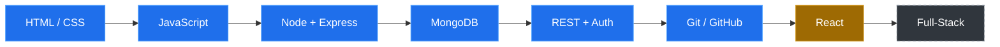
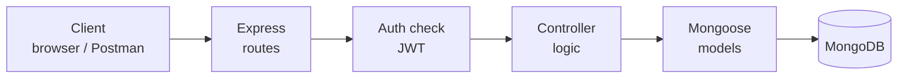

<!-- ===================== HERO BANNER ===================== -->

<!-- Animated typing text (external service) -->

 

---

## 👋 About Me

Hey! I'm **Aman Kashyap**, an IT Diploma student and aspiring Software Engineer from Lucknow, India. I'm passionate about **web development, backend engineering, and building practical real-world applications**.

My journey started with **HTML, CSS, and JavaScript**, then moved into backend development with **Node.js, Express.js, MongoDB, and REST APIs**. I'm now learning **React** and going deeper into backend engineering, database design, and security.

I learn by building projects, debugging problems, and working out how things function internally. I also do **freelance web development** alongside my studies.

> **Build things. Break things. Understand why. Build them better.**

| 📚 Learning | 🔨 Building | 🎯 Going Deeper On |
|:---:|:---:|:---:|
| React | TalkUp, a real-time messaging app | Databases · Auth · Security |

---

## 🛠️ Tech Stack

<table>
  <tr>
    <th>Area</th>
    <th>Technologies</th>
    <th>Status</th>
  </tr>
  <tr>
    <td align="center"><b>💻 Languages</b></td>
    <td align="center"></td>
    <td align="center">JavaScript · C</td>
  </tr>
  <tr>
    <td align="center"><b>🎨 Frontend</b></td>
    <td align="center"></td>
    <td align="center">HTML · CSS · JavaScript</td>
  </tr>
  <tr>
    <td align="center"><b>⚙️ Backend</b></td>
    <td align="center"></td>
    <td align="center">Node.js · Express.js · REST APIs</td>
  </tr>
  <tr>
    <td align="center"><b>🗄️ Database</b></td>
    <td align="center"></td>
    <td align="center">MongoDB · Mongoose</td>
  </tr>
  <tr>
    <td align="center"><b>🔧 Tools</b></td>
    <td align="center"></td>
    <td align="center">Git · GitHub · VS Code · npm · Postman</td>
  </tr>
  <tr>
    <td align="center"><b>📖 Learning Now</b></td>
    <td align="center"></td>
    <td align="center">React 🔄 in progress</td>
  </tr>
</table>

 

HTML and CSS are markup and styling languages, so they're listed under Frontend. JavaScript is used on both the frontend and the backend.

---

## 🧠 Development Journey

<!-- Blue = done, Orange = learning now, Dashed = next goal -->

**How a request moves through the Express + MongoDB apps I build:**

I'm focused on understanding **why technologies work**, not just memorizing syntax.

---

## 📚 Currently Learning

<table>
  <tr>
    <td width="50%">
      <h3>⚛️ React</h3>
      Component-based architecture, state management, reusable UI patterns, and connecting a frontend to backend APIs.
    </td>
    <td width="50%">
      <h3>🌐 Full-Stack Development</h3>
      Connecting modern frontend applications with backend APIs, authentication systems, and databases.
    </td>
  </tr>
  <tr>
    <td width="50%">
      <h3>⚙️ Backend Engineering</h3>
      API design, authentication, database architecture, security, and real-world backend patterns.
    </td>
    <td width="50%">
      <h3>🚀 Production-Oriented Development</h3>
      How applications are structured, tested, maintained, and improved beyond simple tutorial projects.
    </td>
  </tr>
</table>

---

## 🚀 Featured Projects

<table>
  <tr>
    <td width="50%" valign="top">
      <h3>🌐 Bhartiya Vidyapeeth Playway School Website</h3>
      
      
      
A live website for a local school. My work included a child-friendly landing page redesign, production hardening of the codebase, and backend support for student accounts across grade levels.

      <b>Stack:</b> 
      <code>TanStack Start</code> <code>Supabase</code> <code>Netlify</code>
      <!-- Add your link when ready:  <a href="https://YOUR-SITE-URL">Visit site →</a> -->
    </td>
    <td width="50%" valign="top">
      <h3>🎓 Student Hub (Hewett Helper)</h3>
      
      
A student-focused platform designed to provide academic resources and useful utilities for students.

      <b>Project scope:</b> 
      📚 Academic resources · 📝 Previous Year Questions · 👤 User accounts · 🔐 Authentication · 🔌 REST APIs · 🗄️ Database integration
        
      <b>Stack:</b> 
      <code>Node.js</code> <code>Express.js</code> <code>MongoDB</code> <code>Mongoose</code>
      <!-- Add your repo link:  <a href="https://github.com/amanrcbfan99/REPO-NAME">View code →</a> -->
    </td>
  </tr>
  <tr>
    <td width="50%" valign="top">
      <h3>🎵 Spotify Clone</h3>
      
      
A Spotify-inspired application built to practice end-to-end web development.

      <b>Focus areas:</b> 
      🎨 Frontend interface · 🔌 Backend APIs · 🗄️ Database integration · ⚙️ App architecture · 🔐 Authentication concepts
        
      <b>Stack:</b> 
      <code>JavaScript</code> <code>Node.js</code> <code>Express.js</code> <code>MongoDB</code>
      <!-- Add your repo link:  <a href="https://github.com/amanrcbfan99/REPO-NAME">View code →</a> -->
    </td>
    <td width="50%" valign="top">
      <h3>💬 TalkUp</h3>
      
      
A real-time messaging platform I'm building mainly to learn backend engineering properly, with architecture planned before code.

      <b>Done so far:</b> architecture planning and static HTML/CSS screens (registration and home). 
      <b>Planned:</b> authentication, one-to-one and group chat, real-time messaging.
        
      <b>Planned stack:</b> 
      <code>Node.js</code> <code>Express.js</code> <code>MongoDB</code> <code>Mongoose</code>
    </td>
  </tr>
</table>

---

## 📊 GitHub Analytics

### 🔥 Streak

### 📈 Contribution Activity

### 🐍 Contribution Snake

<!-- Needs the GitHub Action in .github/workflows/snake.yml. It shows after the first run. -->

<picture>
  <source media="(prefers-color-scheme: dark)" srcset="https://raw.githubusercontent.com/amanrcbfan99/amanrcbfan99/output/github-snake-dark.svg"/>
  <source media="(prefers-color-scheme: light)" srcset="https://raw.githubusercontent.com/amanrcbfan99/amanrcbfan99/output/github-snake.svg"/>
  
</picture>

---

## 🎯 Current Focus

| | | |
|:---:|:---:|:---:|
| 📚 **CS Fundamentals** | ⚙️ **Backend Engineering** | ⚛️ **React** |
| 🔐 **Authentication & Security** | 🗄️ **Database Knowledge** | 🚀 **Production-Oriented Projects** |
| 🧠 **Problem-Solving** | | |

---

## 🌱 Philosophy & Goal

<table>
  <tr>
    <td width="50%" valign="top">
      <h3>🔁 How I Learn</h3>
      <blockquote><b>Don't just learn technology. Build with it.</b></blockquote>
      <b>Learn → Build → Debug → Understand → Improve → Repeat</b>
      
Real growth comes from solving problems, understanding failures, and continuously improving the way software is built.

    </td>
    <td width="50%" valign="top">
      <h3>🎯 Long-Term Goal</h3>
      
To become a <b>skilled Software Engineer</b> who can design, build, and maintain reliable real-world applications.

      
Not just someone who knows <b>how to write code</b>, but someone who understands <b>how software systems actually work</b>.

    </td>
  </tr>
</table>

---

## 🤝 Let's Connect

  

**💻 Building my skills one project at a time.**
**🚀 Always Learning • Always Building • Always Improving**

 

⭐ Thanks for visiting my profile!

